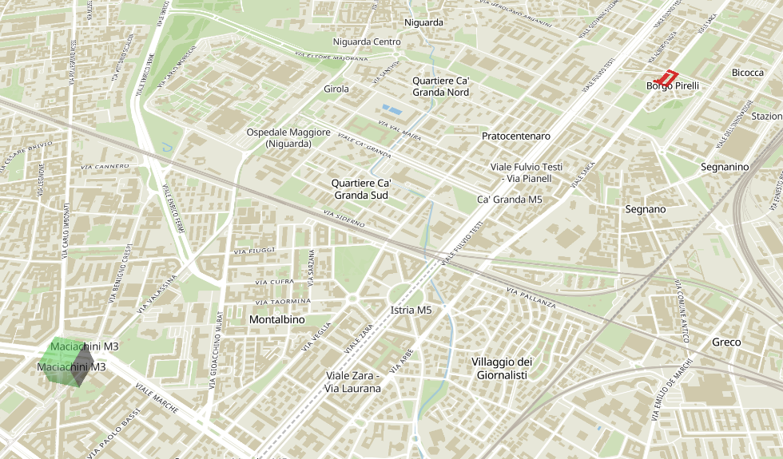

# Demo: MapLibre + Three.js + GeoJSON 3D buildings and trees

This project renders OSM-derived 3D content (extruded buildings, trees, tree
rows, animated water) on top of a MapLibre map, using Three.js as a custom
layer. Unlike the original
[MapLibre 3D model example](https://maplibre.org/maplibre-gl-js/docs/examples/add-3d-model/),
the geometry is not a GLTF model: it is generated at runtime from GeoJSON tiles,
converted from EPSG:4326 to local meters and extruded into meshes.



## How it works

The project has two halves:

1. **`tilegen/`** (Python, run offline) — reads an OSM PBF extract, converts it
   to GeoParquet with [QuackOSM](https://github.com/InsightSoftwareConsortium/QuackOSM),
   then uses [DuckDB](https://duckdb.org) with the `spatial` extension to slice
   the data into static JSON tiles at Web-Mercator zoom 15 (`public/tiles/{x}/{y}.json`).
   Each tile is a GeoJSON FeatureCollection with properties used for rendering:
   - `cmtype: "building"` (with `height`, `base`, `color`, `roof_shape`,
     `roof_color`):
     extruded polygon; height falls back to `building:levels * 3` or 10 m, and
     the color and roof tags are **imputed** from the dataset's own
     distribution when OSM has none (see "Imputed tags" below);
   - `cmtype: "tree"` (point) — with `type` (broadleaf/conifer) and `size`
     (crown radius, m) derived from OSM tags or a hash;
   - `cmtype: "tree_row"` (LineString) — one shared type/size for the row;
   - `cmtype: "water"` — a lake, pond or reservoir (Polygon), or a
     river/canal/stream (LineString) the frontend buffers into a ribbon. Water
     is **clipped to the tile** (a lake spans many tiles), unlike the small
     buildings, and drawn by an animated shader. The `water` property carries
     the sub-kind (`lake`, `river`, `canal`, ...) that picks its color/width;
   - `cmtype: "cemetery"` — a `landuse=cemetery` or `amenity=grave_yard`
     polygon, **clipped to the tile** like a park; the frontend fills it with
     procedural rows of tombstones;
   - `cmtype: "furniture"` (point) — a bollard, bin, bike rack, post box,
     drinking fountain, info board or hydrant. The `furniture` property picks
     the low-poly prop; the frontend merges a tile's props into one mesh;
   - `cmtype: "fountain"` (point) — an `amenity=fountain`, with an equivalent
     diameter (`size`) so a mapped basin gets a sensible circle; the frontend
     builds a stone basin, water surface and jet;
   - `cmtype: "transit_stop"` (point) — a metro entrance, tram stop or bus stop
     (`stop`), with `name` and `shelter` when OSM has them;
   - `cmtype: "terrace"` (point) — a cafe/restaurant/bar with
     `outdoor_seating`, carrying the amenity and name for the popup;
   - `cmtype: "playground"` (point) — a `leisure=playground` with a
     size (equivalent diameter) for the equipment spread;
   - `cmtype: "monument"` (point) — a `historic=monument`/`memorial` or
     `man_made=obelisk`, with the kind and `memorial` sub-kind for the look;
   - `cmtype: "construction"` — a clipped `landuse=construction` area; the tile
     holding the site centroid also carries `crane` and `site_area`;
   - `cmtype: "crosswalk"` (point) — a marked `highway=crossing`, with the road
     `bearing` and full `width` so the frontend can lay the zebra stripes;
   - `cmtype: "road_marking"` (point) — a `highway=stop`, `give_way` or
     `traffic_signals` node, with `directions`, `width`, `lanes`, `oneway` and
     `turn_lanes` for stop lines and lane arrows;
   - `cmtype: "platform"` — a clipped rail/tram platform polygon (line
     platforms are buffered to a 4 m ribbon), with a name and ref;
   - `cmtype: "park_path"` — a foot/cycle path clipped to the tile's green
     areas, with `kind` walk/bike, `surface` and `width`;
   - `cmtype: "power_tower"` (Point) — a `power=tower` pylon, with `height`;
   - `cmtype: "power_line"` (LineString) — a `power=line`/`minor_line` clipped
     to the tile, with an approximate wire `height`, `voltage`, `cables` and
     `wires`;
   - `cmtype: "rail"` (LineString/MultiLineString) — an above-ground rail or
     tram way, clipped to the tile, with `kind` rail/tram;
   - `cmtype: "traffic_signal"` / `"crossing"` (point) — an OSM
     `highway=traffic_signals` or `highway=crossing` node. The plain `crossing`
     is data-only: the frontend does not draw it, but it slows vehicles as they
     pass over it (see below) and it shows up in the debug GeoJSON; a marked
     crossing also gets the separate `crosswalk` feature.

   A tile may also carry a top-level `traffic` array (not a GeoJSON feature):
   the precomputed vehicle routes that fall inside the tile. See below. A
   `parking` array holds the authored parking rows assigned to the tile: each
   has `coords` (the kerb line), `style` (parallel/perpendicular/fishbone),
   `pitch`, `side` and `occupancy`; the frontend places the cars along it. A
   `lamps` array holds the street lamps as `[lon, lat]`; see "Light and
   atmosphere".

2. **`src/`** (TypeScript, Vite app) — a `CoolMap` class wraps the MapLibre map
   and adds a Three.js `CustomLayerInterface`. The map keeps its view in the URL
   as a `#map=zoom/lat/lon` permalink (MapLibre's own hash handling, with the
   `map` prefix so the fragment looks like OSM's): a position can be copied or
   linked, and a pasted link opens there. On every map move it loads/unloads
   tiles within a 3-tile margin of the center (`loadUnloadCoord` in
   `src/main.ts`), converts each feature to a Three.js object via
   `src/geojson_data.ts` and `src/elements3d/` (building, tree, tree_row,
   water, church, cemetery, furniture, fountain, transit, terrace,
   playground, monument, construction, crosswalk, road_marking, platform,
   rail, sidewalk, wall, gate).
   Coordinates are projected from EPSG:4326 → EPSG:3857 meters, centered on the
   map origin and scaled by `cos(latitude)`; the Three.js camera is driven by
   MapLibre's projection matrix. Above zoom 17 the app also builds **windows,
   balconies and one door per building** for the buildings nearest the center
   (geometry in `src/elements3d/facade.ts`, laid out by `facade_layout.ts`): it
   is derived from the footprints and heights already in the tile — no extra
   tile data — merged into one mesh per tile and rebuilt as the zoom crosses the
   gate. Every building also gets a **roof** — flat, gabled, hipped or pyramidal,
   taken from the tile's `roof_shape` (the real `roof:shape`, or imputed by the
   generator), in the tile's `roof_color`, built into the building mesh itself,
   so roofs are always there rather than zoom-gated. Footprints that are concave,
   have a courtyard, or have more than 8 corners stay flat: the ridge fan that
   builds the pitched shapes breaks up on those. There
   is also a (commented out) GLTFExporter
   path to download the current scene as a `.glb`.

### Imputed tags

Only a couple of percent of buildings carry `building:colour` (0.5%),
`roof:shape` (2.1%) or `roof:colour` (1.5%), so the generator fills each of those
in rather than leave the tiles nearly featureless. A missing value is **drawn
from the distribution of the values that are present** in the same extract — a
dataset that is 30% red roofs yields 30% red imputed roofs — and the draw is
seeded from the building's id, so a rebuild reproduces the same tiles. The
frontend never imputes: it reads `color`, `roof_shape` and `roof_color` and maps
anything it cannot draw (e.g. `roof:shape=skillion`) to a flat roof.

### Buildings

Clicking a building inspects it: the popup shows its name and address, height,
wall color, roof shape and roof color (with a swatch), marks the values tilegen
had to impute, and links to the feature's OSM page when the tile carries an id.
The layers menu (the gear at the top left) turns the **windows**, **balconies**,
**roof shapes**, **water**, **church crosses**, **parked cars**, **lamp posts**
and **imputed colors** on and off, with a question mark beside the last one
explaining what imputation means. All but imputed colors are mesh visibility switches (water's is
all-or-nothing: unchecked, no water is drawn); imputed colors are baked into the
geometry and so reload the loaded tiles.

### Light and atmosphere

The scene opens on the real sun over Milan (`src/daynight.ts`): the date's solar
declination and the hour angle (the slider is local mean solar time) give the key
light's direction and altitude. The directional light casts soft shadows over a
2 km cascade that follows the view; a transparent `ShadowMaterial` plane is the
only shadow receiver, so the shadows stay on the ground instead of banding roofs
and walls. Sky/fog colors, ambient warmth
and a whole-canvas warm multiply (`#grade`) follow the same model, so golden hour
is warm with long shadows while noon is neutral.

The **basemap** checkbox swaps the MapTiler style for an empty one, leaving the
3D scene on its own; unchecking it is useful for screenshots and for checking
the generated city against the real map. At night the basemap swaps to the dark
style (with a short fade through black),
the scene lights and parked cars dim, and the street lamps and traffic signals
glow: `tilegen/lamps.py` puts a lamp every 55 m on both sides of every
parking-eligible road, and the signal heads blink red/green on the same global
8 s light the vehicles react to. Both are additive sprites on a thin instanced
post (`src/night_lights.ts`), visible at night above zoom 15. The **lamp posts**
checkbox switches the street lamps and their posts off; the signal heads stay.

### Churches

A church is an ordinary `building=*` polygon in OSM, so tilegen reports the
`building` value (and `religion` for an `amenity=place_of_worship`), and the
frontend does the classifying (`isChurch` in `src/elements3d/church.ts`):
`church`, `cathedral`, `chapel`, `basilica`, `abbey`, `monastery`, or a place of
worship with a `christian`/`christian:*` religion.

A church gets a different look from the apartment blocks around it: when OSM has
no `building:colour` for it, its walls take a seeded warm stone/ochre tone (a real
tagged color still wins), when OSM has no `roof:colour` the roof is slate, and the
roof is forced gabled and pitched 1.3× steeper than the default — a footprint too
complex for a pitched roof (a courtyard, a concave outline) stays flat, as it does
for any building. A **gold cross** (3 m, up to 6 m on a cathedral-sized footprint)
stands on the ridge, or just above the cap of a flat roof; its arms follow the
ridge, so it reads as a cross from the side of the church. The cross is its own
per-tile mesh (kind `church`), so the **church crosses** checkbox hides the
ornament and leaves the church walls as buildings.

### Water

Water is drawn at ground level by an animated shader (`src/elements3d/water.ts`):
lakes, ponds and reservoirs as flat polygons, and rivers, canals and streams as
flat ribbons whose width depends on the class (`WATERWAY_WIDTH`). tilegen clips
each water body to the tile, so a lake or a long canal only stores the piece
that belongs to the tile instead of its whole outline in every tile it touches.

The shader is a `ShaderMaterial` (no lights or normals): a drifting field of two
crossing swells plus some noise, with narrow bright bands that travel across it,
tinted by a per-kind base color baked into the vertex colors. `uTime` is
advanced every frame from wall-clock time, so the surface keeps moving while the
map is still. Water is its own per-tile mesh, so the **water** checkbox in the
layers menu is a plain visibility switch.

Clicking water inspects it, like a building: a popup shows its name (when OSM
has one), its kind (Lake, Canal, ...) and a link to the feature's OSM page when
the tile carries an id. Picking is a point-in-polygon test for areas and a
distance-to-centreline test for waterways.

A water body below ground is drawn at 10% opacity (`UNDERWATER_OPACITY`): OSM
marks this with a negative **`layer`** (the tunnel/bridge ordering — Seveso is
`layer=-2`; `level` is the fallback). The fade is baked into a per-vertex
`aFade` attribute, so a tile's merged water mesh can mix surface and underwater
features. tilegen emits the effective vertical position as the feature's `layer`
and reports the positions it finds: water below 0 (the ones that fade) and roads
above 0 (bridges; see *Bridges and tunnels* below; the road network itself is not
emitted).

### Cemeteries

Cemeteries are OSM areas (`landuse=cemetery` or `amenity=grave_yard`), clipped
to the tile like a park and emitted as `cmtype: "cemetery"`. The frontend leaves
the basemap's cemetery ground and path network visible and fills the area with
rows of simple tombstones (`src/elements3d/cemetery.ts`, layout in
`tombstone_rows.ts`).

The graves themselves are almost never mapped, so the rows are procedural: the
grid is aligned to the cemetery's longest wall, inset from the boundary, given a
seeded gap pattern so it does not read as a checkerboard, and capped at
`MAX_TOMBSTONES_PER_TILE` (6,000). A very large cemetery widens the row and
stone spacing rather than leaving holes in the rows. Most stones are slabs with
a seeded height and pale stone; about one in ten is a simple cross. The stones
are one geometry and one Lambert material per tile (kind `cemetery`), so a tile
is one draw call and the stones darken at night with the rest of the scene. They
are small enough not to cast shadows. Parking and street lamps skip ways whose
midpoint is inside a cemetery, so the grave paths do not fill with parked cars.

### Street furniture

Bollards, bins, bike racks, post boxes, drinking fountains, info boards and
hydrants are emitted as point features (`cmtype: "furniture"`, with a
`furniture` kind) and drawn as simple low-poly boxes by
`src/elements3d/furniture.ts`. Areas (a bike-parking lot) collapse to their
centroid; a line (a rack mapped as a way) keeps its bearing so the rack lines up
with the kerb. A whole tile merges into one Lambert mesh (kind `furniture`), so
the density costs one draw call per tile, not one per object. The props do not
cast shadows and darken at night with the benches and buildings.

Benches remain their own layer (they carry a facing and have a checkbox); the
street-furniture layer is always visible like trees and water.

### Fountains

`amenity=fountain` becomes a point with a `size` (the equivalent diameter of a
mapped area, clamped to 1.5–12 m; a node keeps 2.4 m). The frontend
(`src/elements3d/fountain.ts`) builds a stone basin with a blue water surface
and, for the larger ones, a central pedestal, bowl and jet. The stone is one
Lambert mesh (`fountain`); the water is its own mesh (`fountain_water`) with a
small shader that ripples the basin, adds concentric rings and runs moving bands
up the jet, dimmed at night. Clicking either rings the basin and opens a popup
with its name (when OSM has one) and the OSM link.

### Transit stops

Metro entrances, tram stops and bus stops are point features
(`cmtype: "transit_stop"`, with `stop: metro|tram|bus`, `name` and `shelter`).
The frontend (`src/elements3d/transit.ts`) gives them the Milan look: a metro
entrance has a dark stair opening and an "M" totem — a red panel with a white
M on a single double-sided plane, drawn on a small canvas texture and kept as
its own per-tile mesh; a bus or tram stop has the yellow palina, with a
shelter (posts, roof, glass back and a bench) when OSM says it is covered. The
poles and shelters merge into one Lambert mesh per tile; the sign planes are the
only textured part. Clicking one rings the stop and opens a popup with the stop
name, its kind and the OSM link.

Platforms and the rail tracks themselves are not part of this pass yet; the
precomputed trains still float over the basemap.

### Outdoor terraces

Food and drink places tagged with `outdoor_seating` become a point feature
(`cmtype: "terrace"`, with the amenity and name). tilegen moves the point from
the cafe to the nearest road point outside the building footprint, so the
umbrellas sit at the kerb. The frontend (`src/elements3d/terrace.ts`) lays out
one or two umbrellas with tables and three chairs each, merged into one Lambert
mesh per tile. The umbrellas are seeded
cream/red/green/blue; the terrace is clickable and shows the place name, the
terrace kind and the OSM link. No shadows.

### Playgrounds and monuments

`leisure=playground` becomes a point with an equivalent diameter (6–18 m). The
frontend (`src/elements3d/playground.ts`) draws a sand/rubber patch with a swing,
a slide, a spring rider and, for wider patches, a climbing frame, merged into one
Lambert mesh per tile and clickable.

`historic=monument`, `historic=memorial` and `man_made=obelisk` become
`cmtype: "monument"` points carrying the `kind` and `memorial` sub-kind. The
frontend (`src/elements3d/monument.ts`) picks a pedestal/statue, bust, obelisk,
war memorial, stele, plaque or Stolperstein from those tags, merges the pieces
per tile and makes each one clickable with its name and OSM link.

### Building parts

`building:part=*` footprints are emitted as ordinary buildings. A part's bottom
comes from `min_height`, or `min_level` × 3 m when that is missing; its top from
`height`, else `max_level` × 3 m, else the level count added to the base. The
walls therefore start on the podium and the roof sits at the part's real top
(the Bicocca University example is a 10–15 m volume). Facade windows and
balconies are offset by the same base and a part starting above the street gets
no ground door.

### Construction sites

`landuse=construction` areas are clipped to the tile like a park. The frontend
(`src/elements3d/construction.ts`) draws the dirt/gravel ground, containers and a
material stack, plus one to three tower cranes on the tile that holds the site
centroid (so a site spanning tiles does not sprout a crane in every one). Cranes
are simplified solid masts and jibs; at map zoom the silhouette is the point.
Clicking a site rings it and shows its name, kind and OSM link. `building=construction`
footprints still go through the ordinary building layer.

### Crosswalks

Marked `highway=crossing` nodes become `cmtype: "crosswalk"` points. tilegen
matches each node to its road way and carries the local `bearing` and the full
road `width` (from `width`, then `lanes`, then the highway class); unmarked and
informal crossings, tunnel/bridge decks and nodes with no matching road are
skipped. The frontend (`src/elements3d/crosswalk.ts`) lays white bars along the
carriageway, repeated across it, turns them with the road and merges them into
one mesh per tile. They sit a few centimetres above the ground so they do not z-fight the
basemap, and are clickable with a "Zebra crossing" popup and OSM link. The plain
`crossing` point still drives the cosmetic vehicle slowdown; the two features
share an id.

### Stop lines and lane arrows

`highway=stop`, `highway=give_way` and `highway=traffic_signals` nodes become
`cmtype: "road_marking"` points carrying the road's approach `directions`, width,
lane count and `turn:lanes`. tilegen uses `direction=forward/backward` on stop
and give-way nodes (relative to the matched way), `oneway` and, for signals
without a direction, both approaches. The frontend
(`src/elements3d/road_marking.ts`) draws a solid white stop line 3.2 m before
the node on the approach half of a two-way road (the full width when one-way),
or a dashed give-way line, plus one white lane arrow per approach lane where
there are at least two lanes; `turn:lanes` turns the arrow. One merged mesh per
tile (kind `road_marking`), with a thin dark edge for contrast. These are
painted markings, so there is no popup and no toggle.

### Platforms and rails

Rail and tram platforms are clipped to the tile; a platform mapped as an edge
line is buffered to a 4 m ribbon. The frontend (`src/elements3d/platform.ts`)
raises them into a concrete slab with a white edge and makes them clickable.
Above-ground `railway=rail`/`tram` ways become `cmtype: "rail"` features; the
frontend (`src/elements3d/rail.ts`) lays a ballast ribbon, two rails and sleepers
for heavy rail, two embedded rails for trams, and catenary poles and a wire for
both. Tunnels, covered sections and bridge decks are skipped. The `transit &`
`rails` checkbox hides platforms, rails, stops and metro signs together. One
merged mesh per tile each; no shadows.

### Sidewalks and curbs

Sidewalks are authored in `tilegen/sidewalks.py` from car-road centre lines and
mapped `footway=sidewalk` ways. A car road defaults to a sidewalk on both sides;
`sidewalk:left/right`, then `sidewalk`, override that (`no`/`none` removes a
side, `separate` leaves the separately mapped footway alone, `left`/`right`
limits the side). Width comes from `sidewalk:side:width`, then `sidewalk:width`,
defaulting to 2 m (1.5 m on service roads). Mapped footway sidewalks use their
own `width`/`sidewalk:width`, default 2 m.

tilegen buffers the centre lines, unions them per tile, subtracts the
car-road surfaces with extra clearance, and closes hairline corner gaps. The
frontend (`src/elements3d/sidewalk.ts`) extrudes the resulting polygons into a
0.14 m slab with a darker kerb face, one mesh per tile. The
`#sidewalks-toggle` checkbox hides the layer; it is gated at zoom 16.

### Walls and gates

`barrier=wall`, `retaining_wall`, `city_wall`, `hoarding` and `wall=*` ways
become low solid walls (`src/elements3d/wall.ts`): one box per segment, 1.5 m
high and 0.3 m thick by default, colored by the `wall` material tag. Gates
(`barrier=gate|lift_gate|swing_gate|wicket_gate|sliding_gate`) become two posts
and a closed leaf oriented by the nearest wall. The **walls & gates** checkbox
(`#walls-toggle`) hides both; no shadows.

### Rooftop accessories

Mapped `man_made=water_tower|chimney|antenna|mast` features and
`generator:source=solar` generators become rooftop props. tilegen finds the
containing building and carries its roof height as `base`; the frontend builds
a water tank on legs, a brick chimney, an antenna mast with crossbars or a solar
panel surface. A mapped solar polygon keeps its own footprint; a solar point
gets a small panel array. Buildings carrying solar panels keep a flat top so
the panels are not buried under a pitched roof. All of them are clickable, with
the OSM link. One merged Lambert mesh per tile (kind `rooftop`), no shadows;
`#rooftop-toggle` hides the layer.

### Park paths

Footways and cycleways that pass through a park or green area are clipped to the
park's footprint and to the tile, then drawn as narrow ground ribbons. A mapped
`surface` picks the color (`asphalt`, `gravel`, `paving_stones`, `dirt`, ...);
otherwise walkways are light brown and cycleways brick red. `#park-paths-toggle`
hides the layer. Mapped `footway=sidewalk` ways stay in the sidewalk layer.

### Inspecting GTFS routes

To inspect the optional feed before changing traffic logic, export its shapes:

```bash
cd tilegen
uv run gtfs_routes.py --gtfs ../gtfs.zip \
  --output ../reports/gtfs-routes.geojson \
  --summary ../reports/gtfs-routes.md
```

Each feature carries the route, line, direction counts, headsigns, length,
closed flag and `reverse_of` when another shape is its opposite direction.
When tilegen itself is run with both `--gtfs` and `--report`, it writes
`gtfs-routes.geojson` and `gtfs-routes.md` into the report directory
automatically; the standalone command above is for inspecting a feed without
rebuilding tiles.

### Power lines and pylons

`power=tower` nodes become low-poly pylons, and `power=line` / `power=minor_line`
ways are clipped per tile and drawn as sagging catenary spans. The wire height
comes from the line voltage; the towers use a 30 m default because the extract
does not carry their height. One merged Lambert mesh per tile for the towers and
one `LineSegments` per tile for the wires, both behind `#power-lines-toggle`.
Underground and cable-tunnel sections are skipped.

### Bridges and tunnels

The road and rail network is not emitted (the vehicle routes are precomputed
separately), so a bridge would otherwise be invisible: the road it carries does
not exist as geometry. tilegen therefore emits the bridge ways themselves
(`bridge` set and not `no`, on a highway or railway) and the `man_made=bridge` /
`building=bridge` deck footprints as `cmtype: "bridge"`, clipped to the tile like
water. The frontend raises them into a slab (`src/elements3d/bridge.ts`): a deck
at `h = max(4, 4.5 * layer)` m with a parapet on each edge and both ends ramped
back to the ground over ~15 m, so the deck meets the basemap road instead of
ending in mid-air. The deck width comes from the `highway`/`railway` class.

A tunnel is underground and invisible, so the only honest, visible thing is its
**portal**: tilegen emits a Point (`cmtype: "tunnel"`) at each true end of a
tunnel way that falls in the tile, and the frontend draws a dark frame (two
pillars and a lintel) around the opening there. The ends are the true ones, not
the tile-clipped ones, so no portal appears on an arbitrary tile boundary. Only
roads and railways get one — the extract's thousands of `tunnel=yes` footway and
step underpasses, and culverts/building passages, are left out — and a buried
waterway is still drawn as water. **The underground part is deliberately not
drawn.** Both kinds are per-tile meshes, so the **bridges & tunnels** checkbox is
a plain visibility switch.

### Precomputed traffic

Every vehicle is precomputed offline in `tilegen/traffic.py`; `src/traffic.ts`
is a stateless renderer that samples it. There is no runtime simulation.

- A **loop** is a closed walk of the road (or rail) graph. Cars build them
  randomly: three nodes A, B, C are picked and the shortest directed paths
  A -> B -> C -> A are stitched into a loop (`method="random"`, 1000 loops,
  min 400 m, seeded so a run is reproducible). Trains/trams use the planar
  faces of the rail graph instead (`method="faces"`, min 500 m).
- Speed varies along a loop: each edge travels at its `maxspeed` tag when
  present, otherwise the highway-class default (`primary`/`residential`/...),
  so the loop's `period` is the sum of edge times. Runs carry `(coords, times)`
  keyframes and the vehicle is placed by phase, so it speeds up and slows down
  as it moves between road classes. Vehicles are spread evenly in time by
  `phase`.
- Each loop is split per tile at tile boundaries. A tile stores the pieces
  that fall inside it (`runs`, with `t0`/`t1` seconds into `period`) plus the
  `vehicles` (`phase` + color) on those loops; each entry is tagged `kind`
  (`car`, `train`, `bus` or `tram`) and the renderer merges pieces that share a
  loop `id`. Nothing simulates, nothing rebuilds when a tile arrives, and a
  piece is drawn only while its half-open `[t0, t1)` contains the phase.
- Two fleets come out of the same machinery by default: cars on drivable
  highways (up to 15k vehicles across the 1000 loops) and trains/trams on
  `railway=rail`/`tram` (spacing 800 m, orange).
- With `--gtfs gtfs.zip`, the feed supplies the bus and tram paths instead:
  each `shapes.txt` shape is a one-way loop in its GTFS direction, route type
  3/11 is a bus and type 0 a tram, and only `railway=rail` remains in the OSM
  train fleet. `stop_times.txt` supplies segment travel times and a short dwell
  at each stop; there is no synthetic return trip, so a vehicle pops at the end
  of a shape and reappears at its start. The feed's route short name, long name
  and trip headsign travel with the loop; clicking a moving bus/tram opens a
  popup with its line and direction and starts following it. The feed is
  optional and ignored without `--traffic`.
- Vehicles slow down at **signals and crossings**, cosmetically only. The tiles
  carry the OSM `highway=traffic_signals` / `highway=crossing` nodes as points;
  the renderer matches them to each loop's vertices, turns the windows into
  loop-time with the local speed, and adds a smooth speed bump. A global light —
  axis 0 (roughly E-W) green while axis 1 (N-S) is red, swapping every 8 s —
  decides which: on a red axis the vehicle eases down from 60 m out to ~15% of
  cruise, is back at cruise by the crossing, and eases back over ~255 m; on
  green it nudges up to 1.15x and settles. The bump is smooth and returns to
  zero, so the lap (path and timing) is unchanged: nothing waits, nothing is
  simulated.
- Vehicles are gated on the zoom (and the traffic checkbox) as before. The
  renderer updates a slice of the fleet per frame at ~30 Hz and culls runs
  outside the map bounds, so only the vehicles in view are sampled and placed.

### Parked cars

The kerbs are filled too, statically. `tilegen/parking.py` authors parking as
one line per side of every parking-eligible road (no motorways/trunks, no
`*_link` connectors, no roundabouts, nothing under 30 m), at a pitch set by a
seeded style — parallel, perpendicular or fishbone. Rows that share a kerb (a
service way beside a road, the two carriageways of a dual carriageway) are
deduped before they reach the tile. A row end within 8 m of another car road is
trimmed back by 8 m, so cars do not park in the mouth of a junction; pedestrian
areas are intentionally not part of this check.

The tile carries only the authored rows, clipped at tile seams: `coords`, style,
pitch, side and occupancy. `src/parking_layout.ts` walks each row and places 95%
of the bays in model space; `src/parked_cars.ts` draws the result with the moving
cars' body as one static `InstancedMesh`. Parked cars are lit like the buildings,
so they darken at night, unlike the unlit moving fleet. Like the window detail
the layer only exists above zoom 17 and only for the 3x3 tiles around the
centre: the fully loaded 7x7 window would be ~370k cars, almost all off-screen.
The **parked cars** checkbox is a plain visibility switch.

### Loop report

Because loop length is the main tuning knob, the generator writes a report
(`tilegen/report/`, or `--report-dir`):

- `loops.md` — per fleet, the loop count, vehicle count, min/mean/max length and
  a length histogram, plus a `signals and crossings` section with their counts.
- `loops.geojson` — every loop as a `LineString` (no vehicles), plus a `Point`
  per signal/crossing, for looking at them on a map. By default it keeps only
  loops intersecting `data/milano_polygon.json`; pass `--report-polygon` to clip
  to another area, or `--no-report` to skip the report entirely.

`tilegen/report/` is gitignored (it is generated from local data).

`src/maplibre_setup.ts` fixes a MapLibre v6 issue where the web worker URL is
resolved dynamically and doesn't survive `vite build` — it wires the worker
through Vite's `?worker&url` handling.

## Setup

Prerequisites: Node (with npm) and [uv](https://docs.astral.sh/uv/) for tilegen.

Generate tiles with:

```bash
cd tilegen
uv run main.py ../data/milano_20261016.pbf \
  --polygon-filter ../data/milano_polygon.json \
  --output ../public/tiles --no-raw
```

```bash
npm install

# map tiles are served from MapTiler, you need a (free) API key
echo "VITE_MAPTILER_KEY=your_key" > .env

npm run dev          # dev server
npm run build        # tsc + production build
npm run preview      # serve the production build
npm run prettify     # prettier on src/*.ts

npx playwright install   # once, for the e2e browser
npm run test:unit        # vitest unit tests for the pure traffic math
npm run test:e2e         # Playwright smoke tests
npm run bench            # frame-time benchmark (see below)
```

The app expects tiles under `public/tiles/` (fetch path is `tiles/{x}/{y}.json`
relative to the app origin). A sample set covering Milan at zoom 15 is included;
regenerate them as described below for other cities.

## Performance

The map is CPU/bus-bound rather than triangle-bound: on the sample Milan tiles at
zoom 16 it loads 49 tiles (~3.4M vertices after the tree pass below) and draws
them plus the vehicles in ~18 draw calls per frame, so frustum culling already
keeps off-screen tiles from being drawn. What has actually cost frames so far,
in order of impact:

| change | effect |
| --- | --- |
| index the tree geometry + coarser canopies (5x4 spheres, 5-sided cones, open trunks) | tree vertices 6.29M -> 1.38M, tree triangles 2.10M -> 1.24M, drawn triangles 475k -> 346k |
| precompute the vehicle routes (`tilegen/traffic.py`) instead of simulating them | removes the runtime graph and car-following; the fleet cost is now only placing and drawing the instances |

The car count is a generation knob (`CAR_CONFIG.spacing` in `tilegen/traffic.py`),
and it is the main lever on frame time: the ~16k cars in the loaded window roughly
double the drawn triangles on a software rasterizer. On a GPU 16k instanced boxes
are cheap; in headless SwiftShader they are not.

The tree pass is what moved the frame time least on a software renderer (~5-9%
idle/pan p50, `perf-results` A/B below) and the most on memory: the loaded
geometry drops from ~366 MB to ~165 MB of vertex+index buffers. See `notes.md`
for what is still open (a `getBounds()`-driven tile window, spreading tile builds
across frames).

The facade windows/balconies/doors are the opposite trade: they add geometry
(about 4.4M vertices for the 9 tiles near the center at zoom 17, versus 2.1M for
the base buildings across all 49), so they are built only while zoomed in and
only for those center tiles — nothing is built or drawn while zoomed out.

Roofs sit in between: they are part of the building mesh, so they are always
drawn, and they add about a third to the building geometry (2.08M → 2.79M
vertices across the 49 loaded tiles).

### Measuring performance

```bash
npm run bench                 # frame-time benchmark (own Playwright config)
PERF_MAX_PAN_P90_RATIO=3 npm run bench   # loosen the gate
```

`npm run bench` runs `perf/frame_times.spec.ts` against a dev server it starts
itself. It is deliberately *not* part of `npm run test:e2e`: it takes about a
minute and its timings depend on the machine. It drives the real app in Chromium
with the MapTiler style mocked out (no API key, no network), and goes through
three phases:

1. **startup** — waits for the initial tile burst, then records what is loaded:
   tiles fetched and kept, meshes, vertices and triangles split by kind
   (`building` / `tree`), draw calls, loaded buildings and the vehicle count.
   These numbers are deterministic for a given dataset, so they are the best
   thing to compare between commits.
2. **idle** — 3 s of frame times and main-thread long tasks with the map
   untouched. The vehicles animate, so this is not "0 fps": it is what the app
   costs while the user does nothing, and it is the floor this machine's
   rendering imposes.
3. **pan** — 6 s of scripted pointer drag, sampled the same way, plus the number
   of tile fetches it triggered. This is the phase that catches per-move work
   (tile load/unload).

Each phase is reported as frame-time p50/p90/p99/worst, fps, long-task count and
total long-task time. The WebGL renderer string is recorded too: headless CI has
no GPU and runs on SwiftShader, where the app is rasterizer bound and absolute
fps is far lower than on a device — so read the numbers as relative, and compare
like with like.

For a realistic number, `npm run bench:gpu` runs `perf/interactive.spec.ts`
through `playwright.gpu.config.ts`: the installed Google Chrome, headed with GPU
rasterization, on a 1280x800 viewport. After a warm-up long enough to load tiles
and build the facade detail, it measures three phases — pan (large enough to
cross the tile grid), tilt, and zoom (across the facade-detail threshold) — and
writes `perf-results/latest-gpu.json`. It needs a display and a GPU; without one
Chrome falls back to software and the `renderer` field in the result says so.
The pan/zoom numbers include the app's debounced tile/detail pass, so they
reflect the hitches a user feels, not just steady-state fill.

Results are written to `perf-results/latest.json` (gitignored) as well as
printed, so a run can be kept next to a commit. Two gotchas when comparing:

- **This box is shared.** Absolute frame times drifted from ~75 ms to ~150 ms
  p50 over one afternoon of other browsers/editors running. To compare two
  revisions, run them *alternately* in the same session (A/B/A/B) and diff the
  mins; that is how the tree change above was measured.
- The assertions are loose sanity bounds, not budgets: panning may not cost much
  more than idling (`pan.p90 < 2.5 * idle.p90`, override with
  `PERF_MAX_PAN_P90_RATIO`) and idle must stay under `PERF_MAX_IDLE_P50_MS`
  (default 250 ms). Regressions in the *ratio* are what the test is for; the
  absolute numbers are for the human reading `perf-results`.

## City profiles

`tilegen` can read optional per-city overrides from a folder:

```bash
cd tilegen
uv run main.py ../data/city.pbf \
  --polygon-filter ../data/city_polygon.json \
  --city-dir ../cities/milano \
  --output ../public/tiles --no-raw
```

The folder may contain `city.json`, `buildings.json`, `vehicles.json` and an
`assets/` directory. Building colors, roof colors/shapes and per-building
windows/balconies can be overridden by OSM id or exact name; GTFS line colors
can be overridden by line or route id. Missing files keep the Milan defaults.
See `cities/README.md` for the schemas.

## Inspecting tiles

`tilegen/tile_inspector.py` renders a flat SVG or PNG of an area directly from
the generated tiles: one logical color per `cmtype`, no basemap, lighting or
3D decoration. It is the quickest way to check coverage and whether a feature
made it into the tile.

```bash
cd tilegen
uv run tile_inspector.py \
  --bbox 9.17,45.46,9.20,45.48 \
  --output /tmp/tiles.png \
  --legend
```

Use a `.svg` output for vector inspection or `.png` for a raster; PNG uses
Pillow. `--width` sets the raster width, and `--legend` adds a small color key.

## Regenerating tiles

Put an OSM PBF extract in `data/` (e.g. from
[Geofabrik](https://download.geofabrik.de)), optionally a GeoJSON polygon to
filter the area, then from the `tilegen/` directory:

```bash
cd tilegen
uv run main.py ../data/milano_20261016.pbf \
  --polygon-filter ../data/milano_polygon.json \
  --output ../public/tiles --no-raw
```

The command above writes directly to `public/tiles/` and skips the raw-tag
tiles. Without `--output`, the render tiles go to `tilegen/tiles/` and the raw
tiles to `tilegen/raw_tiles/`; copy the render tiles into `public/tiles/` if you
use that layout. Pass `--no-raw` to skip the raw tiles.

By default the run also precomputes the vehicle routes (see "Precomputed
traffic" above) and writes them into the tiles; pass `--no-traffic` to skip
that step and emit only the geometry tiles. With traffic on it also writes the
loop report into `tilegen/report/` (`--report-dir` to move it, `--no-report` to
skip). Pass `--gtfs ../gtfs.zip` to use the GTFS feed for bus and tram routes;
the file is optional and currently local-only. `--city-dir ../cities/milano`
selects the city profile (it is the default when present); see "City profiles"
above.

`gtfs.zip` is ignored by git; keep it next to `pyproject.toml` and pass
`--gtfs ../gtfs.zip` from `tilegen/` when rebuilding.

To keep the PBF small up front, an `osmium extract` with the same polygon also
works. The tile schema at the top of this README is the current list of emitted
`cmtype` layers.

`tilegen/` is checked by Ruff and [`ty`](https://docs.astral.sh/ty/) via
pre-commit (config at the repo root). After `uv sync --group dev` in `tilegen/`,
enable the hooks once with `uvx pre-commit install`; run them over everything
with `uvx pre-commit run --all-files`. The tilegen unit tests run with
`uv run pytest` from `tilegen/`.

## Notes and current limitations

- Data is loaded per-tile from static JSON files; there is no vector-tile or
  binary-tile path yet, and tiles carry the full GeoJSON text (large for dense
  cities like Milan — rendering works but is clunky).
- Meshes are merged per kind within a tile (one `BufferGeometry` per kind, with
  colors baked into vertex attributes), so a tile renders in a handful of draw
  calls instead of one per feature. The merged geometry is disposed when a tile
  is unloaded.
- Tile loads are debounced (150 ms); failed loads are logged and retried on a
  later move, an in-flight set avoids duplicate concurrent fetches for the same
  tile, and an HTTP 404 is treated as an empty tile (skipped tiles are not
  written).
- The projection origin is recentered when the map center drifts more than two
  tiles, which keeps the `cos(latitude)` approximation accurate. Existing
  meshes are re-expressed in the new origin's space in place (no reload), and
  tiles beyond the ±3 margin are dropped and reloaded against the new origin.
- WebXR/VR support is stubbed out (currently broken upstream, see the comment in
  `src/main.ts`).
- Frontend has Playwright smoke tests (the app boots and the tile pipeline
  responds) plus vitest unit tests for the pure traffic math
  (`src/traffic_math.test.ts`); there are no visual/geometry assertions.
  `tilegen/` has a pytest suite (reported with coverage).

## Ideas / TODO

See `notes.md` for the working list. Highlights:

- dwells at tram stops and junctions (a time keyframe table instead of a single
  constant speed per loop)
- more rail coverage: rails form few closed loops, so most track (lines and
  termini) carries no train; a there-and-back route would cover it
- drive speeds and volumes from data (census counts, GTFS schedules)
- a server that generates tiles on demand with a backing database
  (pyosmium/quackosm + SQLite/JSON), or shortbread/vector tiles
